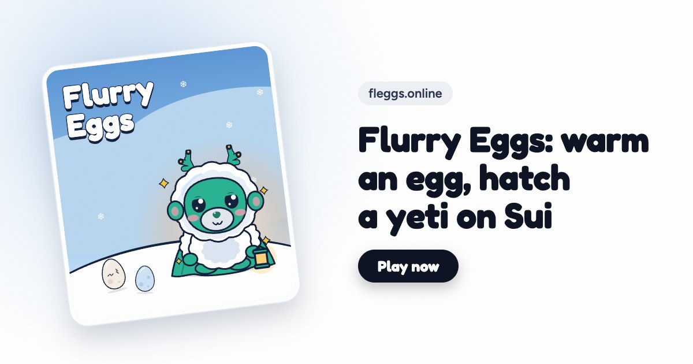
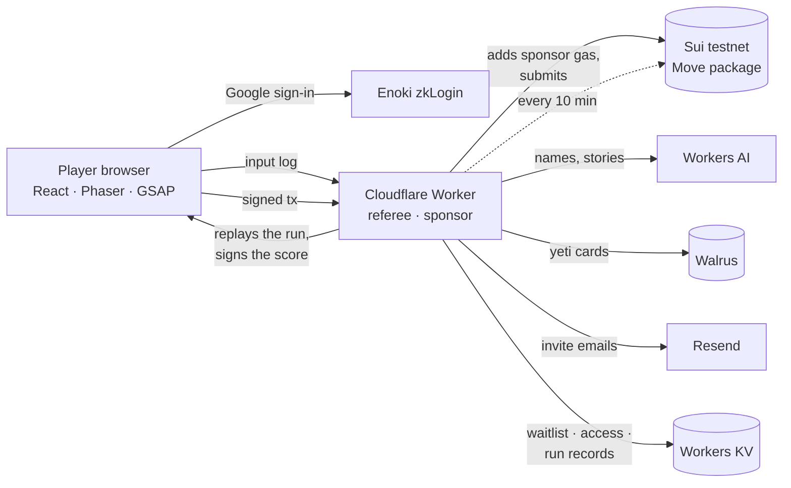

<div align="center">



# Flurry Eggs

**Warm a frozen egg. Hatch a one-of-a-kind yeti on Sui. Train it, merge it, earn real SUI.**

[**Play at fleggs.online**](https://www.fleggs.online) · [@Flurry_eggs on X](https://x.com/Flurry_eggs) · Built for CLAY Hackathon III (Lofi the Yeti × Sui)


</div>

---

## Contents

- [Hackathon submission](#hackathon-submission)
- [What it is](#what-it-is)
- [How it plays](#how-it-plays)
- [Earning real SUI](#earning-real-sui)
- [Invite-only launch](#invite-only-launch)
- [How it works](#how-it-works)
- [Trust and security](#trust-and-security)
- [Repository layout](#repository-layout)
- [Run it locally](#run-it-locally)
- [Configuration](#configuration)
- [Testnet deployment](#testnet-deployment)
- [Tests](#tests)
- [Credits](#credits)

---

## Hackathon submission

| | |
|---|---|
| **Live game** | [fleggs.online](https://www.fleggs.online) |
| **Network** | Sui testnet |
| **Package ID** | `0x670212e326f54f24f2676a3c5d9252cad04ddcd8a422cb4eac42f15392923fa8` ([Suiscan](https://suiscan.xyz/testnet/object/0x670212e326f54f24f2676a3c5d9252cad04ddcd8a422cb4eac42f15392923fa8)) |
| **Sui tech used** | Move objects, zkLogin (Enoki), sponsored transactions, Walrus storage |

This repository holds the game's source: the Move package, the web client, the referee Worker and the shared game, art and chain packages. Internal operations tooling is kept out of it.

## What it is

Flurry Eggs is a cozy collecting game on Sui. Everything a player owns is a real on-chain object: eggs, yetis and their traits. Every score is checked before it is written on chain.

- **No wallet needed.** Players sign in with Google (zkLogin via Enoki) and get a Sui account automatically.
- **No gas for players.** The game pays every transaction through its own gas sponsor.
- **Real value.** Yetis can be sold to the treasury, listed on the market, or staked for a share of shop revenue. Every payout comes from real income, never from new tokens.

## How it plays

| | |
|---|---|
| 🥚 **Warm your egg** | Three 30-second rounds of *Keep It Warm*, each with its own twist: **First warmth** (calm), **Wind gusts** (gusts blow the heat away, with a warning) and **Blizzard** (a fast zone and a combo up to ×1.5). Each stage sets one trait: Fur, Horns, Power. A score of **700+ is Rare**, **400+ is Fine**, anything lower is Common. |
| ✨ **Watch it form** | While you play, the trait grows beside the game: fur tufts, horns that brace in the wind, a power star that brightens with your combo. A live score track pops at Fine and Rare. |
| 🐣 **Hatch** | The egg cracks open and Lofi names the yeti, writes its story and draws its card (stored on Walrus). The name stays hidden until it's final. |
| 🎮 **Train** | Four mini-games (Keep It Warm, Icicle Dash, Lofi Beats, Igloo Stack) earn Snowflakes. Spend them to train traits. You get two free plays per game per day, and extra plays cost 0.02 SUI. |
| 🔥 **Daily streak** | Play the daily run seven days in a row to earn a free egg. |
| 🧬 **Merge** | Max out two yetis of the same level and fuse them into one yeti of the next level, up to Level 5. The fusion is animated with GSAP. |
| 🪺 **One egg at a time** | Once you start warming an egg, you finish and hatch it before starting another. |

## Earning real SUI

Every shop payment is split three ways: **50% to the buyback reserve**, **30% to the stakers' pot** and **20% to operations**. All three percentages are stored on chain in the game config.

| Option | What happens |
|---|---|
| **Sell now** | The treasury buys the yeti at a fixed price per level (L2 0.6 · L3 1.4 · L4 3 · L5 6.5 SUI). No single sale can take more than 2% of the reserve. The yeti is burned. |
| **List** | Sell on the in-game market at your own price. 3% of the sale goes to the reserve. |
| **Stake** | Keep the yeti and earn a share of shop sales, weighted by level (L2 ×1 · L3 ×3 · L4 ×8 · L5 ×20). A staked yeti is locked for 24 h, and rewards can be claimed once per 24 h. |

## Invite-only launch

The site has two modes:

- **Open:** anyone can sign in and play.
- **Invite-only:** the home button becomes **Join waitlist**. Players join with the Google email they will play with. The team approves them, and each approved player gets a branded **"You're in!"** email from `hello@fleggs.online`, sent through Resend.

Signing in shares the Google email with the game server (the `openid` and `email` scopes). An approved player plays as normal. Anyone else sees **"You're on the waitlist · Waiting for approval"**. Players who joined before invite-only mode stay approved.

The gate is enforced by the game server, not just the screen. While the site is invite-only, the gas sponsor and the score checker refuse any account whose email isn't approved.

## How it works



1. **Play.** The browser runs the game and records only your inputs.
2. **Referee.** The Worker replays that input log with the same deterministic simulation (`packages/games`) and the seed it handed out, then signs the resulting score. For egg stages, the Worker also reads the egg on chain to decide which stage's rules apply.
3. **Submit.** The player signs the transaction. The Worker checks it only calls Flurry Eggs functions, adds gas from its coin pool, and submits it.
4. **On chain.** The Move contract verifies the Worker's signature before it accepts a score.
5. **Every 10 minutes**, a scheduled job moves the stakers' pot into the Lodge.

## Trust and security

- **Scores can't be faked.** The contract only accepts scores signed by the Worker, and the Worker computes every score itself by replaying the game.
- **The sponsor only pays for the game.** Transactions may call Flurry Eggs functions and move the player's own SUI, nothing else. Plain transfers are refused.
- **The waitlist can't be bypassed.** The Worker checks Google's signature on the sign-in token and asks Enoki which address that token controls, so nobody can claim someone else's email.
- **Admin actions need the admin key.** They require an `AdminCap` transaction or a fresh signature (within 5 minutes) from a wallet holding one.
- **No secrets in the repo.** All keys live in Worker secrets and the git-ignored `.dev.vars` file.

## Repository layout

| Path | What it is |
|---|---|
| `move/flurry` | Sui Move package: `egg`, `yeti`, `training`, `daily`, `merge`, `shop`, `earn`, `market`, `lodge`, `admin`, `config`, `identity`, `profile`, `onboard`, `attest` |
| `apps/web` | React 18 + Vite app, with Phaser mini-games and GSAP motion. Deployed on Vercel. |
| `apps/worker` | Cloudflare Worker (Hono): referee, gas sponsor (a Durable Object coin pool), lore and cards, waitlist and access, cron |
| `packages/games` | Deterministic game simulations, shared by the browser and the referee, plus the Phaser scenes |
| `packages/shared` | Contract IDs, BCS types, chain readers |
| `packages/art` | Yeti, egg and card art (SVG) |

**Stack:** Sui Move · TypeScript 5.9 · React 18 · Vite 8 · Phaser 3.90 · GSAP 3 · `@mysten/sui` 2 · dApp Kit · Enoki · Hono · Cloudflare Workers, KV and Durable Objects · Workers AI · Walrus · Resend · Vitest

## Run it locally

You need Node 22, pnpm 9, the [Sui CLI](https://docs.sui.io) and a Cloudflare account. Create two Ed25519 keys (`sui keytool generate ed25519`) for the referee and the gas sponsor, and put them in `apps/worker/.dev.vars` (see [Configuration](#configuration)).

```bash
pnpm install
pnpm test                         # every TypeScript package
pnpm move:test                    # Move tests

pnpm --filter @flurry/worker dev  # http://localhost:8787 (reads apps/worker/.dev.vars)
pnpm --filter @flurry/web dev     # http://localhost:5173 (reads apps/web/.env.local)
```

The web app can point at the local Worker or the live one. Set `VITE_WORKER_URL` to choose.

## Configuration

**Web** (`apps/web/.env.local`, and the same names on Vercel):

| Variable | Purpose |
|---|---|
| `VITE_WORKER_URL` | The Worker's URL |
| `VITE_GOOGLE_CLIENT_ID` | Google OAuth client used for zkLogin |
| `VITE_ENOKI_API_KEY` | Enoki **public** API key |

**Worker secrets** (`wrangler secret put …`, or `apps/worker/.dev.vars` for local use):

| Secret | Purpose |
|---|---|
| `ATTESTOR_SK` | Signs verified scores |
| `SPONSOR_SK` | Pays players' gas |
| `ENOKI_API_KEY` | Looks up the address behind a sign-in token |
| `RESEND_API_KEY` | Sends invite emails |
| `ADMIN_TOKEN` | Protects the gas-pool seed endpoint |

**Worker vars** (`apps/worker/wrangler.toml`): `ALLOWED_ORIGINS`, `GOOGLE_CLIENT_ID`, `MAIL_FROM`, and the `WALRUS_*` settings.

## Testnet deployment

| Object | ID |
|---|---|
| Original package (types) | `0x670212e326f54f24f2676a3c5d9252cad04ddcd8a422cb4eac42f15392923fa8` |
| Latest package (calls) | `0xf9b1b91e4011f4c927305a64800a3d9ccbecaebe176370f16f0cbc9d86b7297e` |
| Game config | `0x6877bf79ee84e39962bf302c67ed6a40d14140a2e0cf6c63b0760f165068d61b` |
| Player registry | `0xf7740266022cd4778c117c0c9940dbb1ef631d740250f67def0cf7b0e0230912` |
| Shop | `0x075ea9f122efcb5ff9fde9a8d73c3dab8ec4d3f36b671035d71f312bfacf324e` |
| Market | `0x86d0fef64dabb26a46409b3793180854585ede70c0af5e125790b5a1b04d7c21` |
| Lodge | `0x446432a6df264f802e4c2a7c42f625381285a17bc1b1bc7dccea68347ca646db` |

All IDs live in [`packages/shared/src/deployments.ts`](packages/shared/src/deployments.ts).

## Tests

| Suite | Tests |
|---|---|
| Move (`move/flurry`) | 107 |
| Web (`apps/web`) | 243 |
| Worker (`apps/worker`) | 109 |
| Games (`packages/games`) | 36 |
| Art (`packages/art`) | 36 |
| Shared (`packages/shared`) | 32 |

Run them with `pnpm test` and `pnpm move:test`.

## Credits

A fan-made game inspired by Lofi the Yeti, built for **CLAY Hackathon III** (Lofi the Yeti × Sui).
